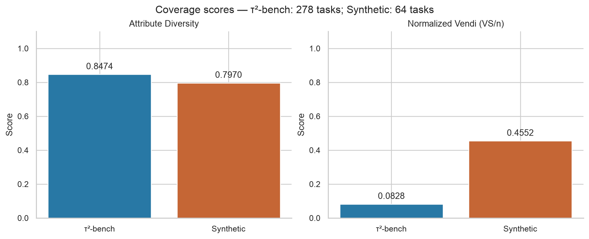
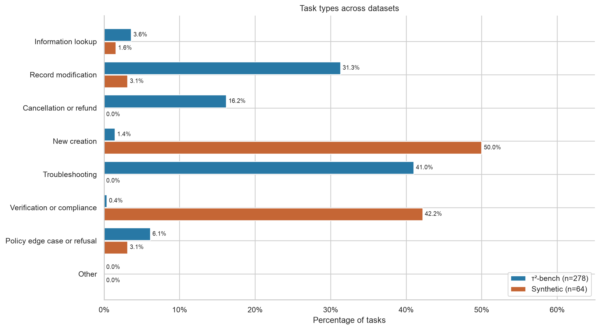
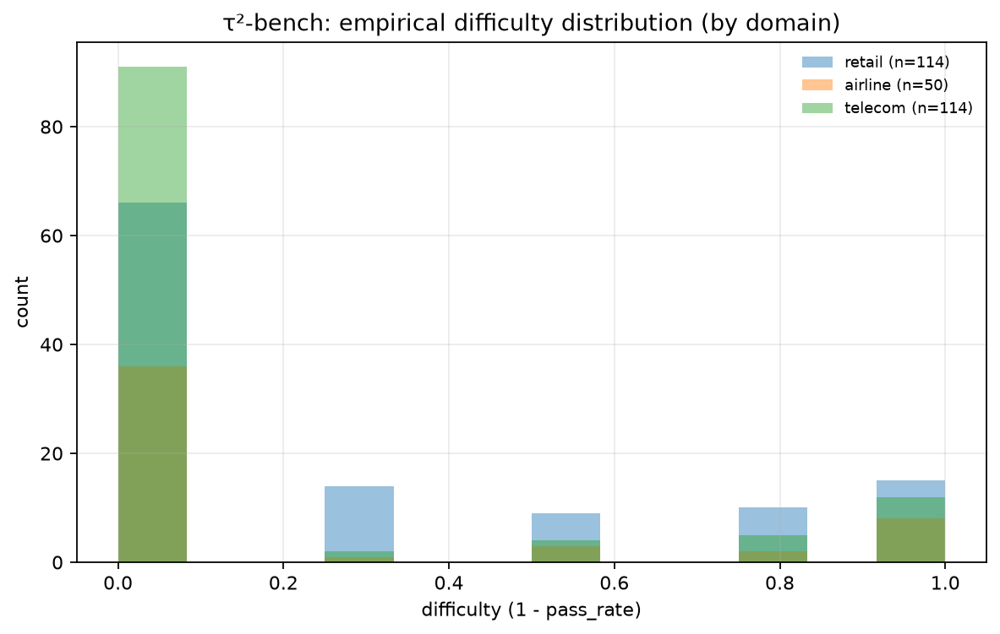
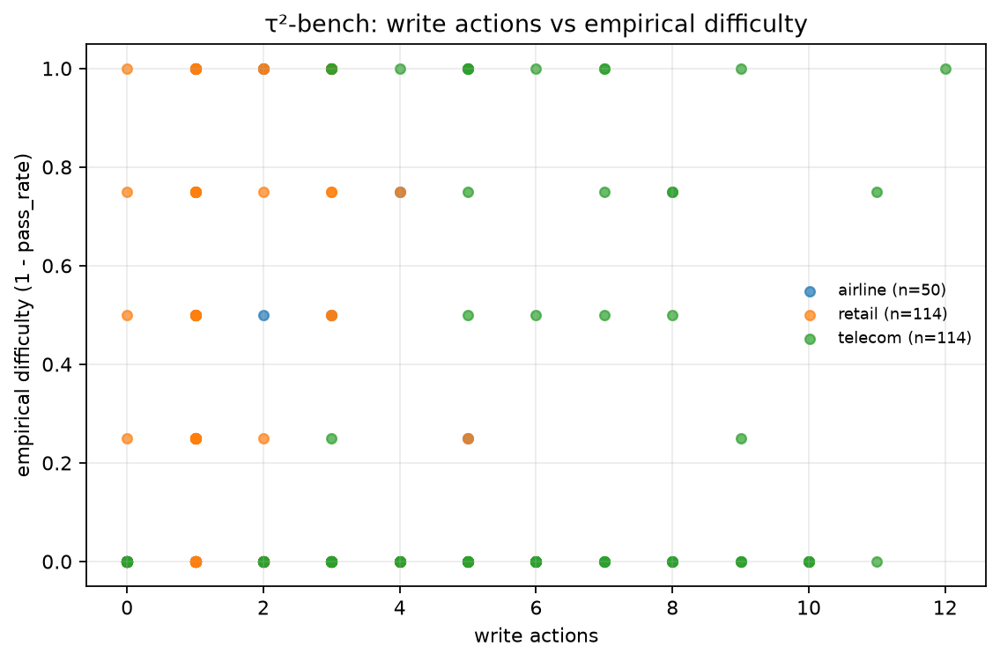

# Final Evaluation Report

**Datasets:** τ²-bench (278 base tasks) and the synthetic benchmark (64 tasks)  
**Reporting period:** Fall 2026  
**Status:** In progress

## Executive summary

The evaluation framework measures **coverage** and **difficulty** consistently across
both datasets.

- τ²-bench has broader task-type and cross-domain structure: attribute diversity is
  **0.8474** versus **0.7970** for synthetic.
- The synthetic dataset is especially weak in task-type diversity: **0.4772** versus
  **0.6712** for τ²-bench.
- The synthetic and τ²-bench datasets both have concentrated tool usage, but the
  synthetic tool component is slightly higher (**0.9855** versus **0.9247**); this
  component compares each dataset's own observed vocabulary and does not prove
  overlap with τ²-bench tools.
- On the structural difficulty measure, τ²-bench averages **2.5935** write actions
  per task and synthetic averages **2.1094**.
- The framework is partially validated for τ²-bench: more write actions correlate
  positively with empirical difficulty overall (Spearman rho **0.1226**, p=0.041),
  though the effect is weak and inconsistent across domains.
- Synthetic empirical difficulty is not available in the committed snapshot. A
  combined, final cross-dataset score must not be reported until synthetic baseline
  trials are added and reproduced under the same protocol.

## 1. Scoring methodology

### Coverage

Coverage has two operational components.

**Attribute diversity**

Attribute diversity is normalized entropy across domain, task type, and tool
attributes. The overall component is the unweighted mean of the three attribute
scores. It is higher when a dataset uses categories relatively evenly and lower
when one category dominates.

**Vendi score**

The Vendi score measures diversity in embedded task descriptions. The committed
implementation reports raw Vendi and `Vendi / n`, where `n` is the task count.
The normalized value is used for cross-size comparisons, but repeated description
text and the embedding model can strongly affect it.

Coverage should be reported as the mean of Attribute Diversity and `Vendi / n`
for side-by-side inspection:

```text
Coverage snapshot = (Attribute Diversity + Vendi / n) / 2
```

Using the committed values gives a τ²-bench coverage snapshot of **0.4651** and a
synthetic coverage snapshot of **0.6261**. The synthetic value is not evidence of
better application coverage: the dataset has fewer tasks, repeated labels, and
no direct matched-domain vocabulary.

### Difficulty

Structural difficulty is the mean expected write-action count per task. A tool is
counted once as read or write according to a committed label table.

```text
Structural difficulty = mean(num_write_actions per task)
```

The structural comparison is **2.5935** for τ²-bench and **2.1094** for synthetic.
When plotted by the repository's existing normalization, these values become
**1.0000** and **0.8133**, respectively.

Empirical difficulty is:

```text
Empirical difficulty = 1 - (valid passed trials / valid trials)
```

It is the preferred difficulty component because it is observed from a fixed
baseline agent. Infrastructure failures are excluded from the denominator.

### Combined scoring system

The final combined dataset score should use an equal-weight scorecard:

```text
Combined Score = 50% Coverage + 50% Empirical Difficulty
```

Each component should be normalized to `[0, 1]` over the evaluated datasets.
Before release, coverage and difficulty should use the same regenerated label,
task, and trial inputs.

The empirical difficulty component is not publishable for synthetic data yet.
Accordingly, this report publishes component scores and does not invent a
synthetic empirical result or an unsupported final combined score.

The structural values can serve only as an **interim difficulty proxy**.

### Weight sensitivity

Before selecting the equal-weight scorecard, the two components were compared
across a range of coverage/difficulty weights. This sensitivity test uses the
committed Coverage snapshot and the structural write-count proxy only:

| Coverage weight | Difficulty weight | τ²-bench proxy score | Synthetic proxy score | Higher |
|---:|---:|---:|---:|---|
| 0.10 | 0.90 | 0.9000 | 0.8320 | τ²-bench |
| 0.25 | 0.75 | 0.7500 | 0.8600 | Synthetic |
| 0.50 | 0.50 | 0.5000 | 0.9067 | Synthetic |
| 0.75 | 0.25 | 0.2500 | 0.9533 | Synthetic |

The ranking reverses near a **15.7% Coverage / 84.3% Difficulty** weighting
under this specific two-dataset min-max normalization. Equal 50/50 weighting
favors synthetic under the structural proxy because synthetic receives the
higher normalized Coverage snapshot.

This test does not freeze the production weight. Equal weighting is retained
for the reporting design because it gives the two validated metric families
equal priority and avoids weighting one family because of a dataset-size artifact.
The final score should be recomputed after synthetic empirical difficulty is
available. A 50/50 weight is most defensible only if the empirical difficulty
and Coverage components are both stable and normalized consistently.

## 2. Side-by-side comparison

| Measure | τ²-bench | Synthetic | Assessment |
|---|---:|---:|---|
| Tasks | 278 | 64 | Synthetic is a 4.3x smaller snapshot |
| Attribute Diversity | 0.8474 | 0.7970 | τ²-bench higher overall |
| Domain entropy | 0.9463 | 0.9282 | Nearly comparable |
| Task-type entropy | 0.6712 | 0.4772 | Major synthetic weakness |
| Tool entropy | 0.9247 | 0.9855 | Synthetic higher within its own vocabulary |
| Vendi / n | 0.0828 | 0.4552 | Synthetic higher, not directly comparable as domain coverage |
| Mean write actions | 2.5935 | 2.1094 | τ²-bench structurally more write-heavy |
| Mean empirical difficulty | 0.2158 | unavailable | Synthetic run required |

### Figure 1. Coverage components



### Figure 2. Task-type mix



The task-type plot identifies the strongest gap: **creation** is 50.0% of synthetic
tasks, while creation plus verification/compliance is 92.2%. Synthetic has no
labeled troubleshooting or cancellation/refund tasks, while τ²-bench has 41.0%
troubleshooting and 16.2% cancellation/refund. Synthetic also has only two
record-modification tasks (3.1%) compared with 87 τ²-bench tasks (31.3%).

### Label and metadata review

The phase-two inputs were reviewed and revised so each task has a common domain,
task-type, tool, and scenario interpretation. This makes Attribute Diversity,
Vendi, and structural difficulty reproducible across the same 278 τ²-bench base
tasks and 64 synthetic tasks.

The labels use one shared task-type vocabulary, while domain vocabularies remain
dataset-specific. Therefore, task-type comparisons are the strongest direct
cross-dataset category comparison. Domain and tool comparisons remain descriptive
unless the labels are mapped to a reviewer-approved common ontology.

## 3. Intra-dataset analysis

### τ²-bench

| Domain | Tasks | Mean write actions | Mean empirical difficulty |
|---|---:|---:|---:|
| Airline | 50 | 0.98 | 0.2250 |
| Retail | 114 | 1.5439 | 0.2675 |
| Telecom | 114 | 4.3509 | 0.1601 |

Coverage values for the two matched τ²-bench domains are:

| Domain | Tasks | Attribute task-type entropy | Vendi / n | Difficulty mean |
|---|---:|---:|---:|---:|
| Airline | 50 | 0.6645 | 0.3088 | 0.2250 empirical; 0.9800 write mean |
| Retail | 114 | 0.4369 | 0.2372 | 0.2675 empirical; 1.5439 write mean |

The task-type entropy values are calculated from the committed labels using the
same normalized-entropy implementation. Airline has broader task-type variation
for this snapshot, while retail has the more extreme record-modification and
cancellation/refund concentration. Airline is therefore higher on task-type
coverage in the label-based comparison.

Vendi/n also ranks airline higher (**0.3088** versus **0.2372**), while empirical
difficulty ranks retail higher (**0.2675** versus **0.2250**). Structural write
difficulty ranks retail higher (**1.5439** versus **0.9800**). These results
show that Coverage and Difficulty are complementary rather than interchangeable:
airline is less write-heavy and has a wider task-type mix, while retail is the
empirically harder small-trial baseline and has a higher write-action mean.

This intra-dataset comparison detects meaningful differences in category balance
and empirical task outcomes. It does not establish causality: task-type labels,
tool availability, domain setup, and four-trial pass-rate noise all contribute.

Telecom has the highest structural mean, but the lowest empirical mean in the
committed four-trial baseline. This is a critical result: write-action count alone
is not sufficient for difficulty. The domain-level validation shows:

- Airline: rho **0.6507**, p < 0.001
- Retail: rho **-0.0980**, p=0.300
- Telecom: rho **0.3432**, p<0.001
- Overall: rho **0.1226**, p=0.041

### Figure 3. Empirical difficulty by τ²-bench domain



### Figure 4. Structural versus empirical difficulty



The overall signal is statistically positive but weak. Telecom's write labels include
actions the customer performs, while the agent's own called tools are a separate
subpopulation. Agent-side write count produces a stronger overall correlation
(rho **0.2372**, p<0.001), but this sensitivity measure is not the only intended
difficulty model.

### Coverage-removal validation

Removing airline or retail from the τ²-bench base split lowers normalized Vendi:

| Tasks scored | Vendi / n | Change from full |
|---|---:|---:|
| Full τ²-bench | 0.0828 | — |
| Without airline | 0.0702 | -0.0125 |
| Without retail | 0.0478 | -0.0350 |
| Without telecom | 0.2207 | +0.1379 |

Removing telecom raises the score because the 114 telecom tasks in the processed
data use only three distinct description strings. This experiment validates that
Vendi/n is sensitive to description repetition, but it does **not** validate an
automatic rule that removing every domain must reduce coverage.

## 4. Weaknesses and prioritized improvement recommendations

The recommendations below are ordered by likely impact and feasibility.

### P0: Run a matching empirical-difficulty baseline on synthetic tasks

**Weakness:** Synthetic empirical difficulty is absent, so the final 50/50 combined
score and synthetic difficulty distribution cannot be reported.

**Change:** Save a synthetic `trials.csv` using the same agent, prompt, model,
decoding settings, and trial count as τ²-bench. Run
`baseline/compute_difficulty.py`, then `difficulty/summarize_difficulty.py`, and
archive the manifest and configuration.

**Target:** Four valid trials per synthetic task; record infrastructure failures
separately.

**Expected impact:** High; makes the final metric, validation, and intra-dataset
analysis complete. **Effort:** Medium.

### P1: Add missing task-type categories

**Weakness:** Creation and verification/compliance dominate 92.2% of synthetic tasks.

**Change:** Generate and manually review cases for:

- troubleshooting;
- cancellation/refund;
- record modification;
- information lookup;
- refusal, ambiguity, and retry/recovery cases.

Add a stratified minimum for each category so no category falls below 10% of the
dataset unless domain experts document it as inappropriate.

**Expected impact:** High; directly raises task-type diversity and likely benchmark
realism. **Effort:** Medium.

### P2: Balance category composition within each synthetic domain

**Weakness:** The broad domain mix hides concentrated category mixes. The category
matrix is uneven across banking, healthcare, insurance, and manufacturing.

**Change:** Publish a domain x task-type count matrix and use quota sampling to
target a balanced, realistic minimum. Preserve at least one:

- read-only lookup;
- write transaction;
- verification or compliance decision;
- exception/recovery path;
- multi-turn clarification.

**Expected impact:** High; improves attribute entropy and prevents a few categories
from dominating a domain. **Effort:** Medium.

### P3: Improve tool and action coverage

**Weakness:** Synthetic tool entropy is superficially high within a small observed
vocabulary and does not establish overlap with τ²-bench tools.

**Change:** Audit tool labels and task sequences; add unsupported combinations,
missing prerequisites, side-effecting actions, and contradictory or partial
requests. Include read/write mixtures rather than isolated tool calls.

**Target:** Add tool-level coverage counts and per-task precondition/postcondition
metadata. Measure shared tool vocabulary explicitly.

**Expected impact:** Medium-high; improves the realism of agent interaction traces.
**Effort:** Medium-high.

### P4: Improve description and output specificity

**Weakness:** Vendi can reward or penalize repeated text even when workflows differ,
and telecom demonstrates why descriptions may not represent the full workflow.

**Change:** Deduplicate near-identical task descriptions, add outcome-specific
ground truth and milestones, and embed both task description and structured
scenario metadata. Add a correctedness spot-check for labels and expected outcomes.

**Expected impact:** Medium; stabilizes coverage scoring and exposes annotation
quality issues. **Effort:** Medium.

### P5: Expand and document diversity validation

**Weakness:** Several conclusions rely on descriptive scores rather than significance
tests or perturbation thresholds.

**Change:** Run controlled subsampling by domain and category, add 95% confidence
intervals or bootstrap intervals, and publish the exact task/label hashes used.
Repeat scoring for five seeds and review variance.

**Expected impact:** Medium; improves reproducibility and prevents misleading small
sample conclusions. **Effort:** Low-medium.

## 5. Recommended implementation sequence

1. Run synthetic empirical trials and freeze the baseline configuration.
2. Recompute all summary files and the final combined score.
3. Add 40-60 domain-balanced tasks targeting missing task types.
4. Re-run coverage, difficulty, and spot checks.
5. Compare the before/after snapshot and only then publish a production score.

## 6. Verification and reproducibility

The final snapshot was verified against the committed score files:

- 278 τ²-bench and 64 synthetic tasks;
- `results/coverage/summaries/attribute_scores.csv`;
- `results/coverage/summaries/vendi_scores.csv`;
- `results/difficulty/summaries/difficulty_summary.csv`;
- `results/difficulty/difficulty_validation.json`;
- `results/difficulty/empirical_difficulty.csv`.

No synthetic empirical trial file is committed. Existing coverage and structural
difficulty figures are in [results/coverage/summaries/](results/coverage/summaries/)
and [results/difficulty/summaries/](results/difficulty/summaries/).

## 7. Limitations

- The two datasets use different domain vocabularies, so domain values are not
  matched application categories.
- Tool entropy measures each dataset within its own observed tool vocabulary.
- Vendi/n depends on description repetition and embedding model behavior.
- τ²-bench empirical difficulty is coarse at four trials per task.
- Retail's structural-empirical correlation is not significant.
- Telecom write counts include customer-side write actions.
- Synthetic empirical success and final combined score remain to be produced.

