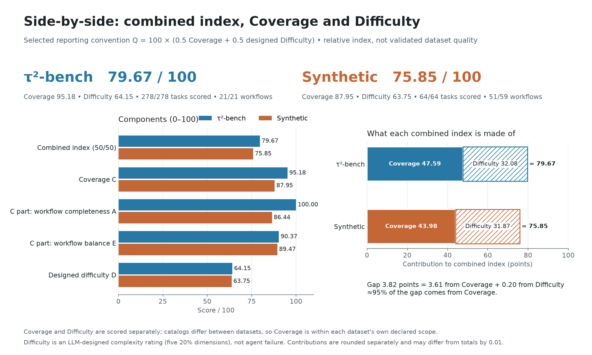
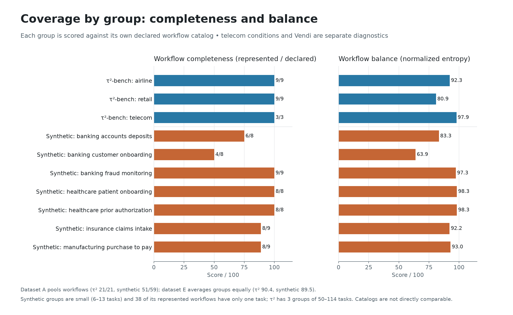
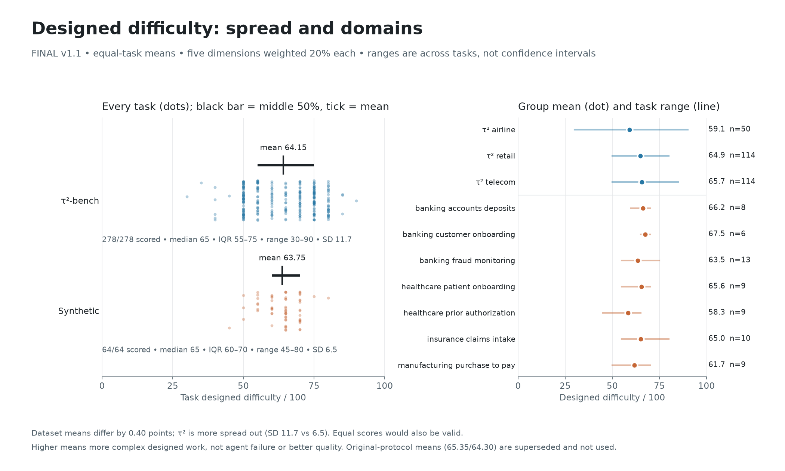
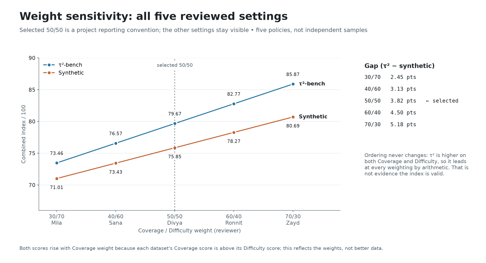

# Side-by-side comparison: combined index, Coverage and Difficulty (#63)

Owners: Zayd and Fatma. Inputs: the frozen selected convention in [`results/scoring/final_index_v1`](../../scoring/final_index_v1/README.md) (#62) and FINAL v1.1 designed difficulty in [`results/difficulty/designed_final_v27`](../../difficulty/designed_final_v27/README.md). Everything here is computed offline, with zero API calls and no score reruns. No source data or scores were changed.

The **combined index** is an exploratory relative coverage-and-challenge index under a project reporting convention (50% Coverage / 50% designed Difficulty). It is **not** validated universal dataset quality and not advisor-approved. Component scores and all five sensitivity settings stay visible below.

## Headline

| | τ²-bench | Synthetic | Difference (τ² − syn.) |
| --- | ---: | ---: | ---: |
| **Combined index (50/50)** | **79.67** | **75.85** | **+3.82** |
| Coverage contribution | 47.59 | 43.98 | +3.61 |
| Difficulty contribution | 32.08 | 31.87 | +0.20 |
| **Coverage C** | 95.18 | 87.95 | +7.23 |
| ↳ workflow completeness A | 100.00 (21/21) | 86.44 (51/59) | +13.56 |
| ↳ workflow balance E (mean group entropy) | 90.37 | 89.47 | +0.90 |
| **Designed difficulty D** | 64.15 | 63.75 | +0.40 |
| Tasks scored | 278/278 | 64/64 | |
| Coverage groups | 3 (50–114 tasks) | 7 (6–13 tasks) | |
| Represented workflows with one task | 1 | 38 | |

Values are rounded for display; full precision is in `dataset_comparison.csv`. Separately rounded contributions may differ from totals by 0.01 (for example, synthetic 43.98 + 31.87 = 75.85 exactly at full precision).



**About 95% of the 3.82-point gap comes from Coverage** (3.61 points), and only 0.20 from Difficulty. Within Coverage, the difference is almost entirely workflow completeness: synthetic leaves 8 of its 59 declared workflows unrepresented. Workflow balance is nearly equal (90.37 vs 89.47).

## Coverage



- **τ²-bench** represents every declared workflow in all three groups. Retail is the least balanced τ² group (E 80.9): its tasks are spread less evenly across its 9 workflows.
- **Synthetic** misses workflows in four of seven groups:
  - banking customer onboarding: 4/8 represented (lowest)
  - banking accounts/deposits: 6/8
  - insurance claims intake: 8/9
  - manufacturing purchase-to-pay: 8/9

  Banking customer onboarding also has the lowest balance (E 63.9). The two healthcare groups and fraud monitoring are complete and highly balanced.
- **Depth:** synthetic groups are small (6–13 tasks), and 38 of its 51 represented workflows have only one task. A complete, balanced catalog with one task per workflow says little about variation within a workflow.

## Designed difficulty



| | τ²-bench | Synthetic |
| --- | ---: | ---: |
| Mean | 64.15 | 63.75 |
| Median | 65 | 65 |
| Middle 50% (IQR) | 55–75 | 60–70 |
| Range | 30–90 | 45–80 |
| Population SD | 11.7 | 6.5 |
| Mean dimension rating (0–4): workload / reasoning / tool use / dependencies / information | 2.74 / 2.65 / 2.55 / 2.47 / 2.41 | 2.86 / 2.33 / 2.94 / 2.58 / 2.05 |

- **The means are effectively tied** (a 0.40-point difference). Equal scores are a valid outcome; nothing requires τ² to score higher.
- **The profiles differ.** τ² has a much wider spread, from very easy airline tasks (30) to hard tasks (90). Synthetic is concentrated around 60–70.
- **Synthetic** rates higher on **workload, tool use and dependencies**. **τ²** rates higher on **reasoning and information discovery**. Similar means therefore hide different kinds of designed complexity.
- **Domain means:**
  - τ²: airline 59.1, retail 64.9, telecom 65.7
  - Synthetic: from 58.3 (healthcare prior authorization) to 67.5 (banking customer onboarding)

## Weight sensitivity (all five reviewed settings)



| Coverage / Difficulty | Reviewer | τ²-bench | Synthetic | Gap |
| --- | --- | ---: | ---: | ---: |
| 70/30 | Zayd (#78) | 85.87 | 80.69 | 5.18 |
| 60/40 | Ronnit (#79) | 82.77 | 78.27 | 4.50 |
| **50/50 (selected)** | Divya (#80) | **79.67** | **75.85** | **3.82** |
| 40/60 | Sana (#81) | 76.57 | 73.43 | 3.13 |
| 30/70 | Mila (#82) | 73.46 | 71.01 | 2.45 |

- **Ordering never changes,** because τ² is higher on both components. This is arithmetic, not validation.
- **The gap shrinks as Difficulty weight rises,** because the datasets differ mostly on Coverage.
- **Both scores rise with Coverage weight** because each dataset's C is above its D.
- **Not a statistical test:** five weight choices are policies, not independent samples, so no significance test applies.

## What can and cannot be compared

- **Can compare:**
  - Each component on its own: workflow completeness and balance within each dataset's declared scope, and designed difficulty on a shared rubric and protocol.
  - How much each component contributes to the gap.
  - How results move across the five weightings.
- **Cannot conclude:**
  - That τ²-bench is a universally *better* dataset. The two workflow catalogs were defined separately, with different group counts and granularity, so 100% completeness of a 21-workflow catalog and 86% of a 59-workflow catalog are not like-for-like.
  - That higher difficulty means higher quality or higher agent failure. Difficulty is an LLM rating of designed complexity, not an execution result.
- **Aggregation units differ:** completeness pools workflows, entropy averages groups equally, and difficulty averages tasks equally. With small synthetic groups, a single task can move a group's score noticeably.
- **Kept out of the index on purpose:** Vendi diversity and τ² telecom conditions (20 categories, 19/20 represented) remain separate diagnostics.
- **Superseded numbers:** the original-protocol difficulty means (65.35/64.30) are not used anywhere here.

## Files

| File | Contents |
| --- | --- |
| `dataset_comparison.csv` | One row per dataset: combined index, contributions, C/A/E/D, task coverage, difficulty spread and mean dimension ratings (full precision) |
| `group_comparison.csv` | One row per coverage group: workflow completeness, entropy, singletons and difficulty mean/median/range/SD for the same group |
| `sensitivity.csv` | All five weight settings, gap and which dataset is higher |
| `*.png` / `*.svg` | The four figures above, in raster and vector form |
| `build.py` | Regenerates everything; asserts the frozen #62 handoff values first and fails if any input drifts |
| `provenance.json` | SHA-256 of every input and of `build.py` |

## Reproduce

From the repository root (needs `matplotlib` and `numpy` from `requirements.txt`):

```bash
python results/comparison/side_by_side_v1/build.py
```

The output is byte-identical across runs.
