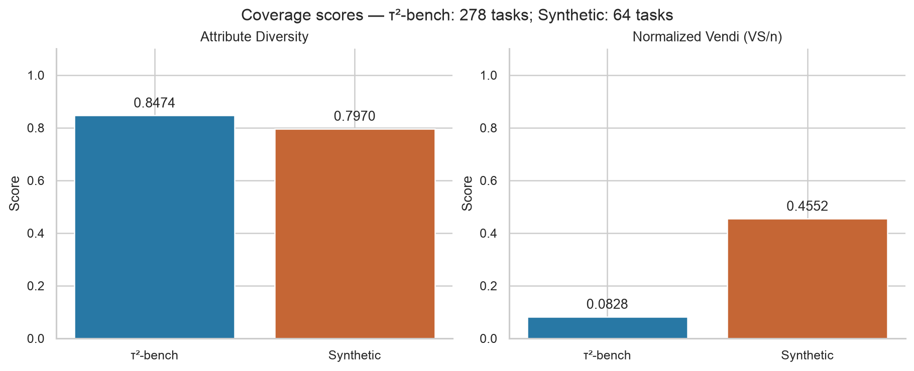
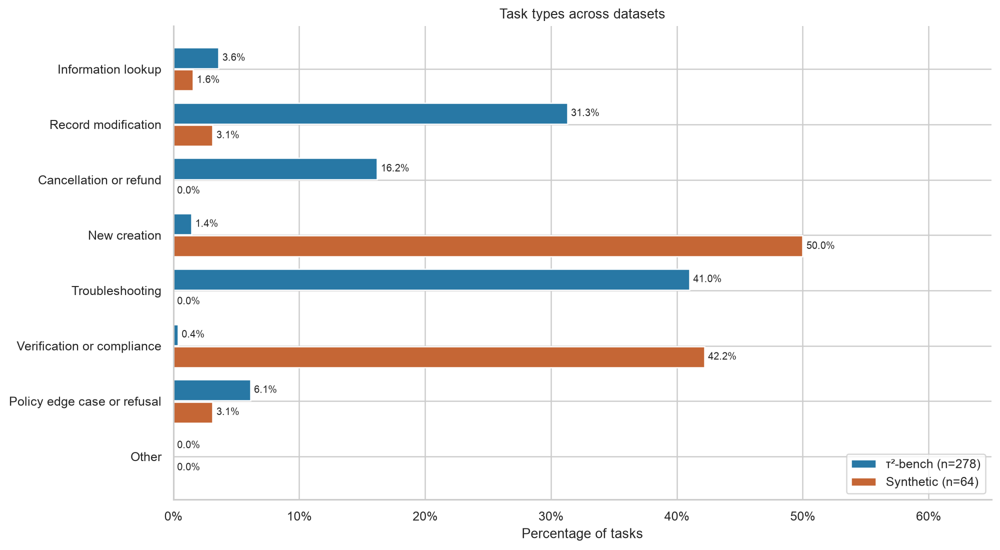
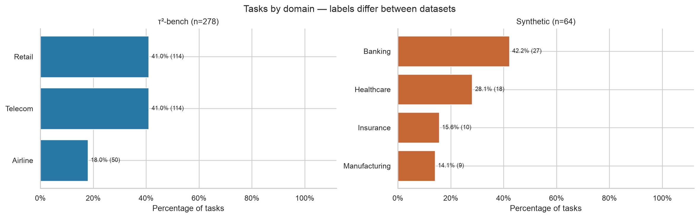
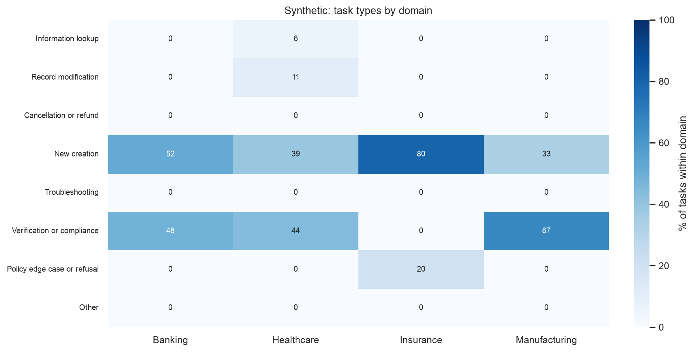
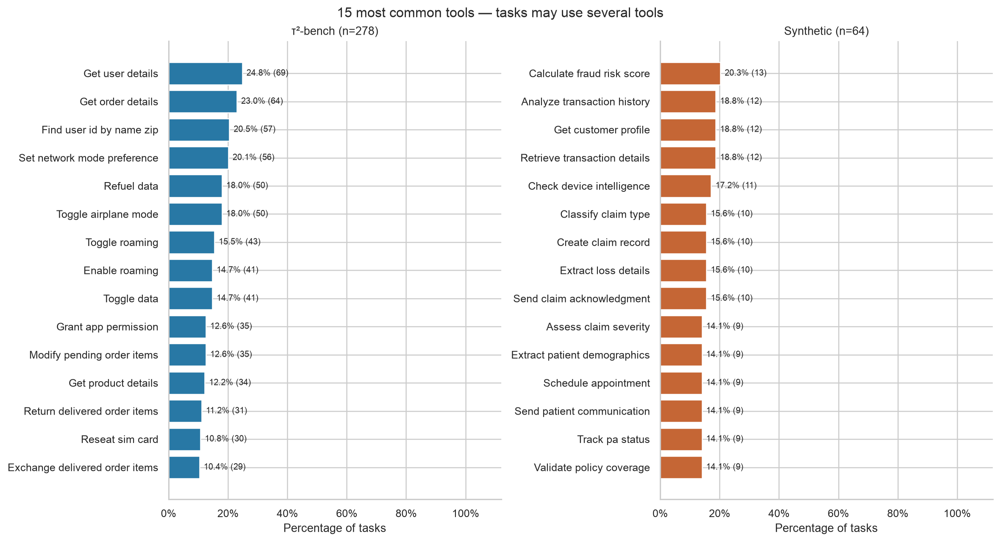
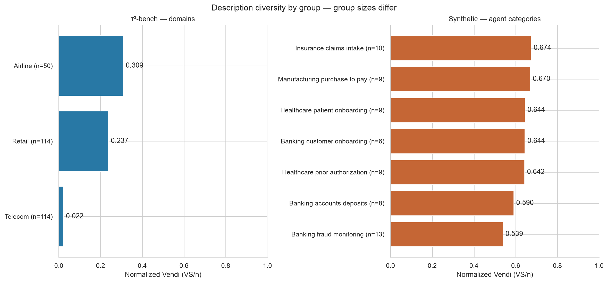

# Coverage summary (issue #18)

This snapshot uses the merged labels and scores for 278 tau2 base tasks and
64 synthetic tasks. Run `python coverage/plot_coverage.py` from the repository
root to regenerate the figures and tables. No API key is needed.

## Overall scores

| Dataset | Tasks | Attribute Diversity | Vendi | Vendi / n |
| --- | ---: | ---: | ---: | ---: |
| tau2 | 278 | 0.8474 | 23.0133 | 0.0828 |
| Synthetic | 64 | 0.7970 | 29.1359 | 0.4552 |

Attribute Diversity averages normalized entropy across domain, task type,
and tools. The synthetic task-type component is lower (0.4772 versus 0.6712),
although its tool component is higher (0.9855 versus 0.9247). Tool entropy
uses each dataset's observed tool vocabulary, so a higher score does not mean
the synthetic tasks cover tau2's tools.

Vendi measures diversity of the embedded task descriptions. Its normalized
value depends on the number of tasks and repeated descriptions. The higher
synthetic value does not establish better coverage of the benchmark's
domains or workflows. In the processed tau2 data, telecom has only three
distinct descriptions across 114 tasks; its normalized Vendi is 0.0219.

## Task types and gaps

- Creation accounts for 32/64 synthetic tasks (50.0%); verification or
  compliance accounts for another 27/64 (42.2%). Together they make up 92.2%.
- No synthetic tasks are labeled troubleshooting or cancellation/refund.
  These types account for 114/278 (41.0%) and 45/278 (16.2%) tau2 tasks,
  respectively.
- Only two synthetic tasks involve record modification (3.1%), compared
  with 87/278 tau2 tasks (31.3%). One synthetic task is information lookup.
- Neither dataset has tasks labeled `other`. Its zero count is retained
  for completeness; it is not itself a coverage target.

These are gaps in the current labels. Review candidate tasks and labels
before deciding which workflows to add.

## Breakdown by domain

The domain labels differ: tau2 contains airline, retail, and telecom;
synthetic contains banking, healthcare, insurance, and manufacturing.
These are separate application areas, so there is no direct matched-domain
comparison in this snapshot.

| Synthetic domain | Tasks | Current mix | Areas to review for expansion |
| --- | ---: | --- | --- |
| Banking | 27 | 14 creation, 13 verification | Lookup, record changes, cancellation, troubleshooting, refusal cases |
| Healthcare | 18 | 7 creation, 8 verification, 2 record changes, 1 lookup | Cancellation, troubleshooting, refusal cases |
| Insurance | 10 | 8 creation, 2 refusal | Lookup, record changes, verification, cancellation, troubleshooting |
| Manufacturing | 9 | 3 creation, 6 verification | Lookup, record changes, cancellation, troubleshooting, refusal cases |

These suggestions need domain review: not every task type will be appropriate
for every agent. The [tau2 heatmap](task_type_by_domain_tau2.png) also shows
concentration: all telecom tasks are labeled troubleshooting, while retail
is mostly record modification and cancellation/refund.

## Tools and description diversity

The overview shows the 15 most common tools in each dataset. The full
[tau2 tool heatmap](tools_by_domain_tau2.png) and
[synthetic tool heatmap](tools_by_domain_synthetic.png) include every tool.
Values are percentages of tasks using a tool, counted once per task.
Multiple tools can occur in the same task. These labels describe task tools,
not observed success rates from agent runs.

The existing synthetic Vendi scores are grouped by seven agent categories,
while its attribute labels use four broad domains. The chart preserves the
original score groups; averaging their Vendi scores would not produce a
valid broad-domain Vendi score. Task counts are shown because group sizes
differ.

## Files for review

- `distribution_counts.csv`: exact counts, denominators, and percentages
  for all plotted distributions, including per-domain values.
- `attribute_scores.csv` and `vendi_scores.csv`: the existing scores used.
- `plot_metadata.json`: input hashes and plotting package versions.
- PNG figures for reports and SVG figures for resizing.

The plotting script checks that task IDs, Vendi totals, and saved attribute
counts match the selected inputs. It does not relabel tasks or recompute
embeddings. If the dataset changes, regenerate the scores and labels together,
then regenerate these plots and update this summary.
