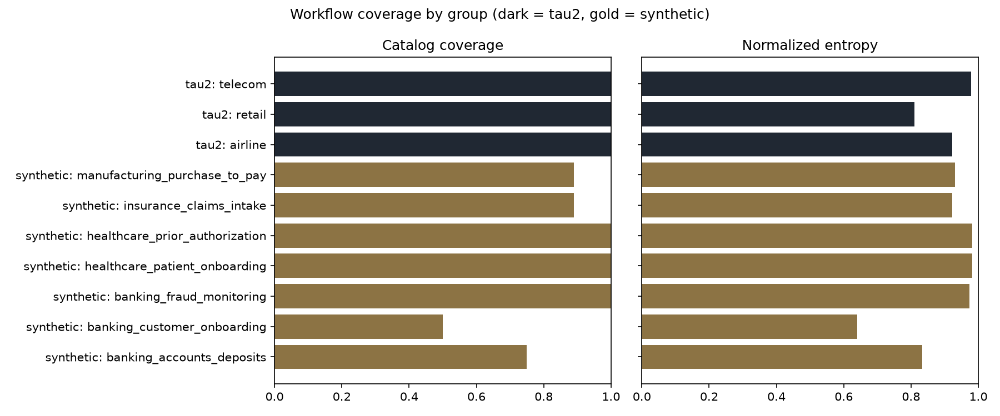
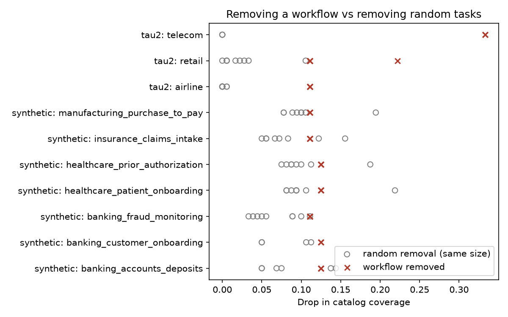

# Workflow-based coverage: recompute and validate

Run from the repository root:

```bash
python labeling/workflows.py                    # workflow labels
python coverage/workflow_coverage.py            # scores, validation, plots
python coverage/workflow_coverage.py --vendi    # same, plus Vendi (downloads all-MiniLM-L6-v2)
```

## How the scores work

Each group (a tau2 domain or a synthetic agent) is scored against its own
fixed catalog of declared workflows, including workflows with zero tasks.
Telecom issue conditions are scored as a second attribute. For each group:

- **Catalog coverage** = workflows with at least one task / workflows in the catalog
- **Normalized entropy** = −Σ p log p / log K, K = catalog size

A task with several workflow labels counts once for each label, the same rule
the October Attribute Diversity uses for tools. Labels are never joined into
one combined string, so a combination of workflows is not treated as a new
workflow.

Groups use different catalogs, so a score is only comparable within a group.
The dataset rows below summarize the groups; they are not a ranking of two
datasets on a shared scale.

## Results

| Group | Tasks | Workflows (represented / declared) | Catalog coverage | Normalized entropy |
| --- | ---: | ---: | ---: | ---: |
| tau2: airline | 50 | 9 / 9 | 1.00 | 0.92 |
| tau2: retail | 114 | 9 / 9 | 1.00 | 0.81 |
| tau2: telecom | 114 | 3 / 3 | 1.00 | 0.98 |
| tau2: telecom conditions | 114 | 19 / 20 | 0.95 | 0.93 |
| synthetic: banking accounts/deposits | 8 | 6 / 8 | 0.75 | 0.83 |
| synthetic: banking customer onboarding | 6 | 4 / 8 | 0.50 | 0.64 |
| synthetic: banking fraud monitoring | 13 | 9 / 9 | 1.00 | 0.97 |
| synthetic: healthcare patient onboarding | 9 | 8 / 8 | 1.00 | 0.98 |
| synthetic: healthcare prior authorization | 9 | 8 / 8 | 1.00 | 0.98 |
| synthetic: insurance claims intake | 10 | 8 / 9 | 0.89 | 0.92 |
| synthetic: manufacturing purchase to pay | 9 | 8 / 9 | 0.89 | 0.93 |

| Dataset | Represented / declared workflows | Catalog coverage | Mean group entropy |
| --- | ---: | ---: | ---: |
| tau2 | 21 / 21 | 1.00 | 0.90 |
| synthetic | 51 / 59 | 0.86 | 0.89 |



- Every tau2 workflow has tasks. Telecom, which the old task-type label put
  entirely under troubleshooting, splits into MMS (49), mobile data (36) and
  service (29) problems, with 19 of 20 issue conditions represented.
- 8 of 59 declared synthetic workflows have no test cases. Banking customer
  onboarding is missing 4 of its 8 workflows.
- Of the 51 synthetic workflows that do have tasks, 38 have exactly one task.
  Entropy is high in most synthetic groups because each workflow appears
  about once, not because the dataset is large.
- Retail has the lowest tau2 entropy: item changes appear in 73 of 114 tasks,
  while order reinstatement appears once.

## Validation: removing a workflow

For each represented workflow, all tasks with that workflow are removed and
the group is re-scored with the same catalog. The comparison removes the
same number of random tasks from the group, 20 times.

| Dataset | Attribute | Removals | Coverage fell | Coverage below random | Entropy fell | Entropy below random |
| --- | --- | ---: | ---: | ---: | ---: | ---: |
| tau2 | workflow | 21 | 100% | 100% | 100% | 100% |
| tau2 | telecom condition | 19 | 100% | 100% | 100% | 100% |
| synthetic | workflow | 51 | 100% | 84% | 100% | 84% |



- **Coverage falling is guaranteed by construction**: removing a workflow's
  tasks always leaves that workflow at zero. It is a sanity check, not
  evidence on its own.
- **The comparison with random removal is the real test.** In tau2, removing
  a workflow always lowers coverage and entropy more than removing the same
  number of random tasks, because each workflow has many tasks and random
  removals rarely empty one.
- **In synthetic, 8 of 51 removals did no worse than random.** These are
  workflows with 2 tasks in groups where most workflows have 1. Removing any
  2 random tasks then also empties about 2 workflows. This reflects how thin
  the synthetic workflows are, not a fault in the metric.
- Entropy is not guaranteed to fall under removal, but it fell in every case
  here.

## Vendi

`--vendi` scores each group's descriptions twice, using the same rule for both
datasets: the original description, and the description followed by
`Workflows: <workflow names>`. It also repeats the workflow-removal test with
Vendi. Outputs: `workflow_vendi_scores.csv` and `workflow_vendi_removal.csv`.

| Group | Tasks | Vendi (description) | Vendi (+ workflow names) |
| --- | ---: | ---: | ---: |
| tau2: airline | 50 | 15.44 | 13.56 |
| tau2: retail | 114 | 27.04 | 22.98 |
| tau2: telecom | 114 | 2.50 | 2.49 |
| synthetic: banking accounts/deposits | 8 | 4.72 | 4.46 |
| synthetic: banking customer onboarding | 6 | 3.87 | 3.18 |
| synthetic: banking fraud monitoring | 13 | 7.01 | 5.95 |
| synthetic: healthcare patient onboarding | 9 | 5.80 | 5.03 |
| synthetic: healthcare prior authorization | 9 | 5.78 | 5.42 |
| synthetic: insurance claims intake | 10 | 6.74 | 5.96 |
| synthetic: manufacturing purchase to pay | 9 | 6.03 | 5.75 |

- Telecom's 114 tasks still count as about 2.5 distinct tasks, matching the
  earlier per-domain result (VS/n 0.0219). Its descriptions repeat within each
  workflow family, so workflow names cannot separate them; the condition
  attribute above covers that variation.
- Adding workflow names lowered Vendi in every group. Every task gains the same
  `Workflows:` line, so the texts look more alike to the embedding model.
  Putting labels into the text does not help Vendi measure workflow variety.

**Workflow removal with Vendi** (72 workflows, each tested with both texts):

| Dataset | Text | Removals | Vendi fell | Vendi below random |
| --- | --- | ---: | ---: | ---: |
| tau2 | description | 21 | 100% | 81% |
| tau2 | + workflow names | 21 | 100% | 86% |
| synthetic | description | 51 | 100% | 59% |
| synthetic | + workflow names | 51 | 100% | 65% |

Raw Vendi usually falls when tasks are removed, so "Vendi fell" is expected.
Compared with random removals of the same size, Vendi responds to losing a
workflow less reliably than catalog coverage does (89% overall), especially in
synthetic. Vendi measures how different the description texts are, not which
workflows are present, so the two coverage scores should be reported together.

## Limitations

- Workflow labels for tau2 retail and airline are curated project labels, not
  official tau2 annotations. A teammate should review them before final use.
- Synthetic labels describe each case's declared workflow; they do not
  establish that the case or its reference calls are correct.
- With 6–13 tasks per synthetic agent, one task changes a group's scores
  noticeably.
