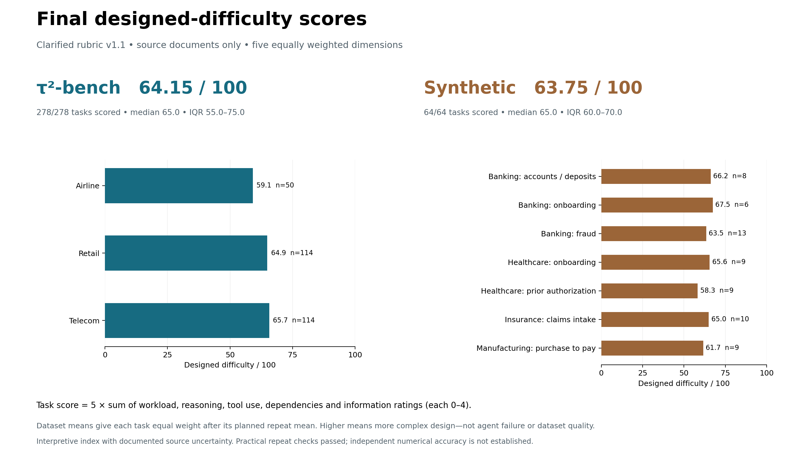
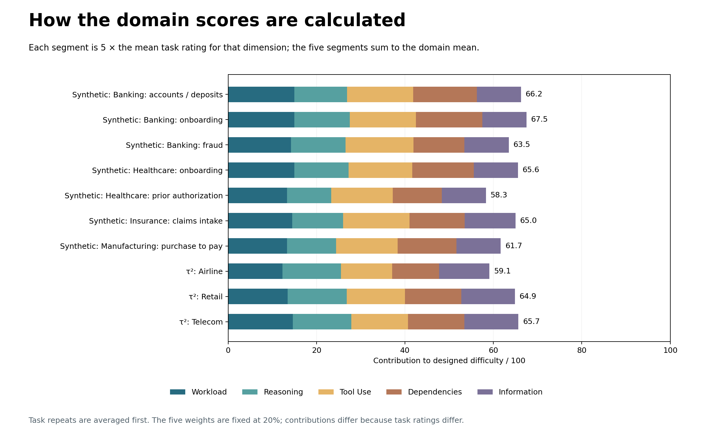
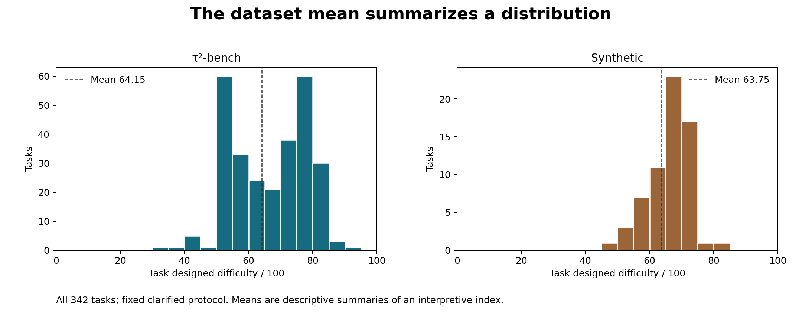

# Final designed-difficulty metric v1.1

**τ²-bench: 64.15/100 — all 278 tasks. Synthetic: 63.75/100 — all 64 tasks.**

The authorized clarified-protocol run is complete: **342/342 tasks, 348/348 planned judgments, 341 new API calls and seven exact reused results**. No API/format failures or automatic retries. These are the current versioned designed-difficulty results; the original-protocol results remain preserved separately.



## What the metric measures

An LLM reads task designs, applicable steps, milestones, tool contracts, policies and intended exits. It estimates required complexity; it does **not** run agents or measure correctness, failure probability or dataset quality.

Rate workload, reasoning, tool use, dependencies and information discovery from 0–4, with **20% weight each**. Compute **score = 5 × sum of the five ratings**, locally from unchanged model levels. Average planned judgments within each task first, then give each usable task equal weight. Do not average the domain means equally when their task counts differ.

Example from the saved results: `DigitalAccountOpeningAgent_W1_TC2` has dimension levels (3 + 2 + 3 + 3 + 2), giving **65.00/100**. The task CSV contains the actual levels for every case; the evidence archive retains all unit assessments and rationales. A score of 80 is not proven twice as difficult as 40.

The clarification counts discovery and required preparation before a valid exit, then excludes work no longer required after a decisive mandatory exit. It preserves uncertainty when several diagnostic paths are defensible. It does not charge all alternative branches or assume that initial state shown only to the judge is already known to the agent.

## Domain results

- **synthetic/banking_accounts_deposits: 66.25/100**, 8/8 tasks.
- **synthetic/banking_customer_onboarding: 67.50/100**, 6/6 tasks.
- **synthetic/banking_fraud_monitoring: 63.46/100**, 13/13 tasks.
- **synthetic/healthcare_patient_onboarding: 65.56/100**, 9/9 tasks.
- **synthetic/healthcare_prior_authorization: 58.33/100**, 9/9 tasks.
- **synthetic/insurance_claims_intake: 65.00/100**, 10/10 tasks.
- **synthetic/manufacturing_purchase_to_pay: 61.67/100**, 9/9 tasks.
- **tau2/airline: 59.10/100**, 50/50 tasks.
- **tau2/retail: 64.87/100**, 114/114 tasks.
- **tau2/telecom: 65.66/100**, 114/114 tasks.

Each value is the equal-task mean inside that domain, using the same formula and prompt. Domain names receive no bonus or penalty. Different task requirements produce different dimension ratings.



## Distributions and interpretation

Native median **65.00**, middle 50% **55.00–75.00**, range **30.00–90.00**. Synthetic median **65.00**, middle 50% **60.00–70.00**, range **45.00–80.00**.



Similar dataset scores can be legitimate. Policy length, domain mix, available state and source granularity affect the assessment. Higher designed difficulty alone does not establish higher quality. This is an anchored, interpretive index with documented uncertainty, not independent numerical ground truth or Sandra-approved weights.

## Validation and audit

All 348 results passed the unchanged schema, source-evidence, applicability, numeric and request-binding checks. All response IDs are unique. **203 offline tests passed**, including spending caps, stop-on-error behavior, bounded in-flight requests, unresolved-intent protection, missing-repeat handling, mixed-protocol rejection and archive safety. The six-case paired development study met the frozen practical repeat gates: maximum range 10, mean range 3.33 and simple/complex control gap 35. These tests support implementation and consistency; they do not prove the model's judgments correct.

Model: GPT-6 Sol, low reasoning, 10,000 output-token cap. Exact inputs, requests, responses, source bindings, model settings, spending intents and metadata disagreements are retained. Arithmetic totals are derived locally; raw-model totals remain in the audit. No model rating or supplied task was manually edited. All previously protected user files are unchanged.

New-call usage: **16,353,076 input tokens + 559,606 output tokens = 16,912,682 total**. Reused observations are excluded from that usage. No dollar cost or billing-owner inference is made.

The completed archive replay and source-only framework checks are recorded in [verification](verification.json). They reproduce scores without another API call. The exact source checkout and code revision are required; restore/rebase only filesystem roots, never payloads or ratings.

## Comparison with the original version

The original native result was 65.35; the clarified result is 64.15 (change -1.19). Original synthetic was 64.30; clarified is 63.75 (change -0.55). The complete inventory was rescored under one protocol, not patched selectively. Differences combine wording effects and ordinary model variation; they are not isolated causal estimates.

Post-scoring diagnostics are in [crosschecks](crosschecks.json) and [reference diagnostics](reference_crosschecks.json). Supplied tags were withheld from the judge and are annotations, not gold labels. Native comparable tags remain unavailable. Shared source evidence, ties and related variants limit independence. Native semantic profiles remain partial supporting work, not an extra weighted component or a blocker to these completed numeric results.

## Files to use

- [Readable task scores](task_scores_readable.csv): each task, score, five mean ratings, repeat coverage and uncertainty.
- [Domain summary](domain_summary.csv): counts and summary statistics.
- [Complete machine-readable results](task_scores.json) and [summary](summary.json): dataset, domain and workflow results.
- [Original-versus-clarified comparison](protocol_comparison.csv): every task on the same inventory.
- [Evidence-bearing judgments](audit/judgment_evidence.json), [source bindings](audit/source_bindings.json) and [run manifest](audit/run_manifest.json).
- `audit/frozen_packet.tar.gz`: exact requests, inputs, responses, results, authorizations and spending logs. Contains no API key.
- [Fixed method](../../../docs/evaluation/designed_difficulty_metric_v1.1.md).

Offline replay:

```bash
python -m difficulty.reproduce_clarified_design \
  --report-dir results/difficulty/designed_final_v27 \
  --out .cache/replayed_clarified_v27
```

Recompute through the framework after restoring the packet:

```bash
python run_all.py --difficulty-mode source-only \
  --design-clarified-packet .cache/replayed_clarified_v27 \
  --output-dir .cache/framework_clarified_v27
```

Neither command runs an agent, downloads embeddings or sends an API request. Keep historical execution/coverage metrics separate. The previous full-run permission was limited to these 341 new calls; no additional paid work is implied by completing this release.
