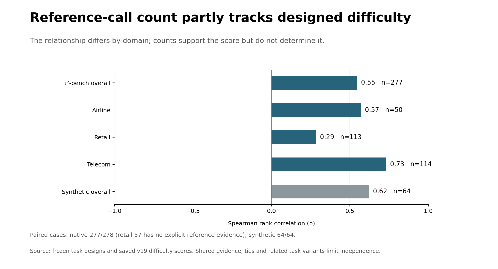

# Shared reference-design cross-checks

All 342 saved task scores are unchanged. Zero API calls. These exact source observables are supporting diagnostics, not the difficulty formula.



## Native findings

- **tau2**: reference-call/score Spearman rho 0.547, paired n=277; missing references 1/278.
- **tau2/airline**: reference-call/score Spearman rho 0.572, paired n=50; missing references 0/50.
- **tau2/retail**: reference-call/score Spearman rho 0.286, paired n=113; missing references 1/114.
- **tau2/telecom**: reference-call/score Spearman rho 0.731, paired n=114; missing references 0/114.
- **synthetic**: reference-call/score Spearman rho 0.622, paired n=64; missing references 0/64.

Reference lists vary in completeness; zero listed calls does not mean no work. Native retail 57 remains unavailable for these reference features. Repeated calls, distinct tool names and argument leaves are separately reported, with sample sizes and ties.

See the [frozen definitions](../../../docs/evaluation/native_design_crosschecks_v1.md). P-values are exploratory, task variants are clustered, and shared evidence prevents independent-validation claims.

The original synthetic reference counts match all 64 existing structural profiles exactly. One synthetic Python reference expression has dynamic argument values: its call count is available, but its argument-leaf count is unavailable. No source code was executed.

These correlations use the new source-only score. Historical write-count versus empirical failure-rate correlations remain a different analysis.

The equal-count telecom example flags possible overcounting before a mandatory escalation; see [examples.md](examples.md). This is a consistency concern, not a confirmed scoring correction.

## Remaining scope

#50 and parent #71 remain open. Native operations, business checks and coordination need source-bound semantic annotations under the existing counting rules. Tool counts, actor counts and environment assertions are not substitutes. Native difficulty tags remain unavailable. The original synthetic profiles and tag comparisons remain separate and unchanged.

Equal-count example pairs in crosschecks.json were selected after scoring for illustration, not as independent validation. Their source-backed explanations are supplied in examples.md.

A source-bound [review queue](semantic_review_queue.json) identifies 18 locked-SIM escalation cases for the next semantic check. Selection is based on explicit fixture setup and transfer references, not the score; flags are not confirmed errors. No human labels or revised scores were invented.

Reproduce these reference diagnostics offline:

```bash
python -m difficulty.native_design_crosschecks --scores results/difficulty/tau2_final_v19/comparison.json --inventory .cache/design_numeric_v1/tau2_final_refs_v19/inventory_combined.json --out .cache/native_crosschecks_fresh
```

The frozen inventory can also be recovered from the v19 packet archive using the offline replay tool. No API key is required.

Argument-leaf counts describe the canonical input representation supplied to the judge; they do not establish that every original argument or required interaction was supplied. The main reference-call counts are separately checked against all existing synthetic profiles.
