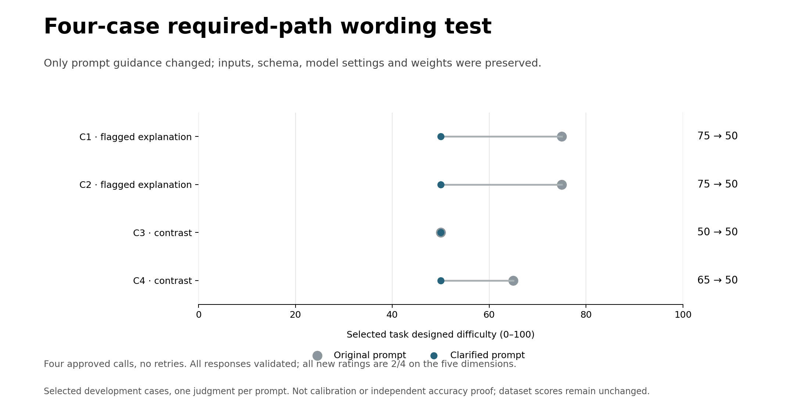

# Required-path wording probe: four calls completed

**Four of four responses passed validation. Four API calls, zero retries or format/API failures. Published scores remain τ²-bench 65.35 and synthetic 64.30.**

## Results

- **C1 (explicit_chain_concern): 75 → 50**, change -25.
- **C2 (explicit_chain_concern): 75 → 50**, change -25.
- **C3 (explicit_exclusion_contrast): 50 → 50**, change +0.
- **C4 (explicit_exclusion_contrast): 65 → 50**, change -15.

These are four selected development tasks, not a dataset mean. All new ratings are 2/4 on all five dimensions; each total is 50/100, not a 50% success rate.

## What changed in the explanations

The two original concerns now retain identification, device checks and any missing-SIM reseating, but explicitly exclude payment and line resumption after the locked-SIM exit. The first contrast remains 50. The second contrast falls from 65 to 50 even though its original dependency explanation already excluded payment; reasoning, tool-use and information ratings also narrowed. Therefore this is not proof that only a billing-chain error was repaired.

Three equal scores triggered an inspection before the fourth approved call. The first two explanations correctly include missing-card discovery/reseating, while C3 has no missing-card setup and does not invent one. Equal broad anchor bands can be legitimate; these four ties still warrant testing for over-compression on genuinely different early-exit tasks.

Only the system-prompt addendum changed. Frozen task payloads, evidence-index/schema, model/config, numeric dimensions and weights were verified identical. Private-helper code inspected during the source review was not added to the judge context. No review labels, desired scores or baseline scores went to the model.

## Decision

Keep this wording as an **experimental development clarification**. It is promising for interpreting required work, but it is not calibrated or independently validated. Do not overwrite the published scores or launch a full rerun from these four cases.

The next validation should include non-escalating complex tasks and harder early-exit tasks, plus repeated judgments, under a separately frozen and authorized plan. Check source-grounded work and excluded branches, not whether scores necessarily go down. Native operation/check/coordination annotations remain unfinished in #50.

## Audit files

- comparison.csv / comparisons.json: all four paired scores, dimensions and original/new explanations.
- judgment_evidence.json: exact new API bodies, inputs, raw wire outputs, resolved source evidence, original results and response/model metadata.
- run_manifest.json: actual four-call accounting, token usage, protocol and limitations.
- preparation_manifest.json: original preparation-only snapshot (api_calls=0 describes preparation, not the completed run).
- uniform_inspection.json: decision made after the third identical score.

[Prior 18-case assistant source review](../required_path_review_v21/README.md) · [Draft wording](../../../docs/evaluation/required_path_clarification_draft_v1.md). The current judge and original benchmark sources remain unchanged.
