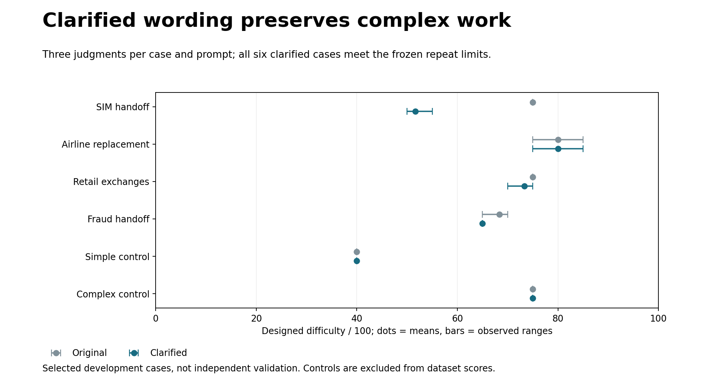

# Paired repeatability check completed

**The clarified wording meets the frozen practical numeric gates. This supports a versioned full run, not a claim of ambiguity-free rules or independent numerical accuracy.**

All **24 newly authorized repeat calls** completed, with no API/format errors or retries. Combined with the earlier five new calls and seven exact cached judgments, the study has **36 usable judgments: six cases × two prompts × three judgments**. No full-dataset rescoring calls have been made.



## Results: original mean → clarified mean

- SIM handoff: **75.00 → 51.67**. Clarified scores 50, 55, 50 retain discovery and reseating as applicable, then stop at the mandatory security handoff rather than charging unrelated repairs.
- Airline replacement: **80.00 → 80.00**. Both arms span 75–85; balances, cancellation checks, itinerary comparison, payment allocation and replacement booking remain.
- Retail exchanges: **75.00 → 73.33**. Clarified scores 70, 75, 75 retain both orders, eligibility, variants, payment and confirmations; the boot fallback replaces a prohibited same-option exchange.
- Fraud handoff: **68.33 → 65.00**. Clarified scores are all 65; investigation, risk assessment and a complete package remain necessary before routing.
- Simple authored control: **40.00 → 40.00**.
- Complex authored control with the same two listed steps: **75.00 → 75.00**.

Clarified maximum within-case range is **10** (limit 10), mean range **3.33** (limit 5), and the mean complex-minus-simple gap is **35** (minimum 10). The original arm also meets its practical repeat tolerances: maximum 10, mean 2.50. Neither non-target airline nor retail mean change exceeds the 10-point review threshold. Arms are analyzed separately, not pooled into a dataset score.

These are observed repeat ranges, not confidence intervals. Prior scores were visible during selection, the cases are purposive development examples, and the historical baseline responses were generated earlier. Controls are authored examples, not gold difficulty labels or dataset-mean inputs. Overlapping dimension definitions and subjective anchors remain limitations.

## What we can finalize tonight

The numeric formula remains **5 × (workload + reasoning + tool use + dependencies + information)**, using five integer levels from 0–4 and equal 20% weights. No weight tuning or preferred dataset ordering is needed. The clarification has supporting consistency evidence and retains complex work before valid exits. Its interpretation is still a model-based estimate with documented uncertainty.

The formula, evidence protocol and missingness rules can be frozen operationally; we cannot promise that all 0–4 judgments or all task documents have no ambiguity. See the [plain-language decision sheet](../../../docs/evaluation/designed_difficulty_finalization_decision.md).

Published primary scores are still **native 65.35/100** and **synthetic 64.30/100**, under their recorded original prompt. Do not substitute these six repeated means into the primary report or label the old means as clarified-protocol results.

An offline full-run proposal preserves all **342 tasks and 348 planned judgments** from the original repeat convention. Seven exact same-repeat/request cached results can be reused, leaving **341 new calls**. A full run requires approval that accepts the documented remaining judgment/source uncertainty. The user's later conditional permission—only if there is absolutely no ambiguity—does not satisfy that condition, so **none of those 341 calls was started**. The proposal remains prepared, not authorized or adopted.

The remaining 275 unauthored native semantic profiles are supporting analysis, not a prerequisite for calculating the numeric metric. #50/#71 remain open; do not expand that supporting work into an unnecessary blocker for tonight's versioned score.

## Audit and offline checks

[Comparison CSV](comparison.csv), [reliability gates](reliability.json), [source-review observations](semantic_review.json), [call accounting](run_manifest.json), and [verification](verification.json) retain the results and limitations. Raw replies, canonical evidence-bearing judgments, exact compressed requests/inputs, original preparation snapshots and spending intents are included. Every response was revalidated and all 36 response IDs are unique. Eight new offline tests verify arm separation, completeness, error/missingness handling and the frozen gates. Existing primary files and all 80 protected user files are unchanged.

This phase used **729,040 input tokens and 28,332 output tokens**, totaling 757,372. These counts cover only the 24 new repeats; no dollar charge or key ownership is inferred.

The full-run proposal's request/input fingerprints and seven cache bindings are published separately in `proposed_full_run_manifest.json` and `proposed_full_run_cache_bindings.json`. Its status is preparation only. Reproducing the study analysis uses saved data, with no model call:

```python
import json
from pathlib import Path
from difficulty.required_path_repeatability import summarize
p = Path('results/difficulty/required_path_repeatability_v26')
result = summarize(json.loads((p/'observations.json').read_text()),
                   json.loads((p/'run_manifest.json').read_text())['thresholds'])
assert result == json.loads((p/'reliability.json').read_text())
```
