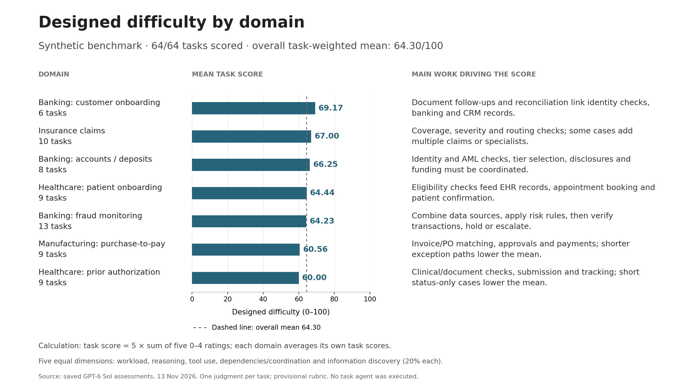

# Domain scores — presentation notes

Overall synthetic designed difficulty: **64.30/100**, all 64 tasks scored.

Each task gets five 0–4 ratings (workload, reasoning, tool use, dependencies and information), with equal 20% weights. Multiply their sum by 5. Each domain score averages the task scores in that domain; the overall score weights every task equally.

- **Banking: customer onboarding: 69.17/100** (6 tasks). Document follow-ups and reconciliation link identity checks, banking and CRM records.
- **Insurance claims: 67.00/100** (10 tasks). Coverage, severity and routing checks; some cases add multiple claims or specialists.
- **Banking: accounts / deposits: 66.25/100** (8 tasks). Identity and AML checks, tier selection, disclosures and funding must be coordinated.
- **Healthcare: patient onboarding: 64.44/100** (9 tasks). Eligibility checks feed EHR records, appointment booking and patient confirmation.
- **Banking: fraud monitoring: 64.23/100** (13 tasks). Combine data sources, apply risk rules, then verify transactions, hold or escalate.
- **Manufacturing: purchase-to-pay: 60.56/100** (9 tasks). Invoice/PO matching, approvals and payments; shorter exception paths lower the mean.
- **Healthcare: prior authorization: 60.00/100** (9 tasks). Clinical/document checks, submission and tracking; short status-only cases lower the mean.

These explanations summarize the saved task assessments. Scores describe designed complexity; this one-judgment-per-task run does not establish independent difficulty truth.

