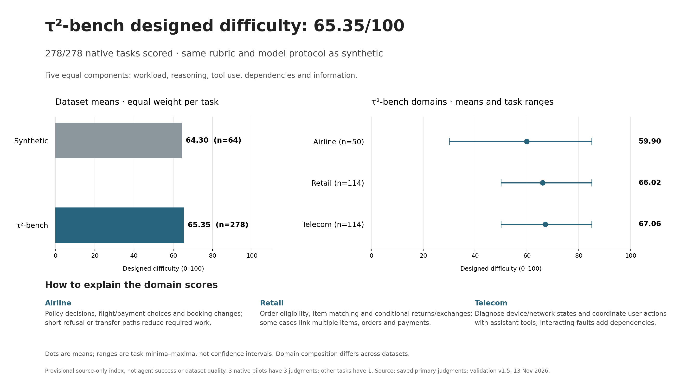
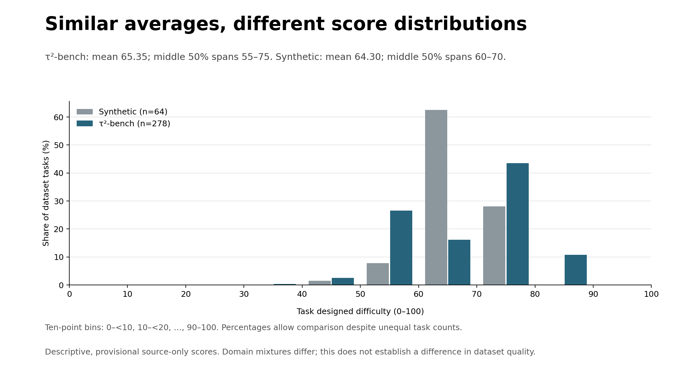
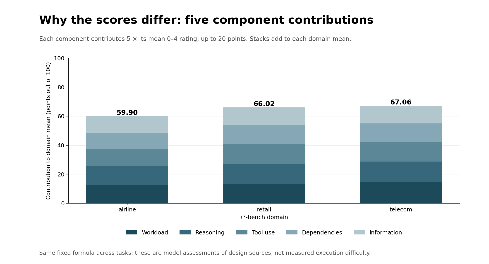

# Final computed designed-difficulty comparison

**τ²-bench: 65.35/100** (278/278 tasks scored). **Synthetic: 64.30/100** (64/64). These are complete computed results for the frozen provisional rubric, not independently validated difficulty truth.



The averages differ by only 1.05 points, while native scores have a wider spread: IQR 55–75 versus synthetic 60–70. These describe this fixed inventory; no independent significance or dataset-quality claim follows.



## Domain scores

- **Airline: 59.90/100**, 50/50 scored; median 60.00, task range 30.00–85.00.
- **Retail: 66.02/100**, 114/114 scored; median 70.00, task range 50.00–85.00.
- **Telecom: 67.06/100**, 114/114 scored; median 70.00, task range 50.00–85.00.

Each task receives five 0–4 ratings: workload, reasoning, tool use, dependencies and information. Each contributes 20%, so **task score = 5 × sum of the five ratings**. Required steps, tool arguments, business rules and dependencies justify these ratings; counts do not determine them automatically. A three-judgment pilot is averaged first, then every task has equal weight.

The native headline is `(50 × airline mean + 114 × retail mean + 114 × telecom mean) / 278 = 65.34772182`. Use unrounded domain means from domain_summary.csv for exact arithmetic. It is not the unweighted average of three domains. Synthetic remains the original primary mean `4115/64 = 64.296875`; later diagnostic repeats do not replace its task scores.

## Why the scores differ

Airline combines narrow policy/refusal/transfer cases with multi-flight, multi-passenger and payment-constrained booking changes. Retail combines eligibility checks, item matching, returns/exchanges and linked order/payment requirements. Telecom often requires diagnosing interacting device/network states and coordinating user-tool actions with assistant-side account changes. These descriptions summarize source-backed task assessments; they are not separate domain-specific scoring rules.



Airline case 46 scores 30: the intended endpoint is a narrow human transfer for an unsupported insurance-only refund, without changing the flight. The hardest saved airline example scores 85 and coordinates several bookings and payment allocations. Equal listed step or call counts need not imply equal difficulty. Per-task rationales, applicable-unit decisions and canonical evidence are in audit/judgment_evidence.json.

## Source treatment and comparison limits

- Exact scope: local τ²-bench base split, 50 airline + 114 retail + 114 telecom tasks, benchmark revision and source hashes in the audit. This is τ²-bench, not the older τ-bench v1.
- The model reads source designs, policies, tools, intended completion requirements and selected task-relevant original initial records. Initial overrides and fixture setup are distinguished from agent workload. Environment assertions are included; no agents, tools or fixture code were executed.
- Missing synthetic-style milestones are not fabricated for native tasks. Native retail task 57 lacks explicit completion references: its user goal and policy can support a defensible design assessment, with the limitation separately flagged. No reference actions were invented.
- Same model, prompt/schema and five-dimension rubric across datasets. Domain mixture, policy length, source granularity and reference completeness still differ. A similar or lower native score is not automatically a bug, and higher difficulty is not greater dataset quality.
- Native equivalent easy/medium/hard tags and precomputed structural profiles are unavailable. The cross-check retains missingness instead of creating labels or zero features. Synthetic tag association remains weak (rho 0.187, n=64), with ties and shared-source limitations.
- The historical write-count versus empirical failure-rate findings remain separate in results/framework/difficulty_validation.json. They do not enter this designed-difficulty formula.

## Reliability, calls and validation

All 158 offline tests passed after the versioned arithmetic fix and before resuming paid expansion. The current-format ten-domain sample has three judgments per task: maximum range 5, mean range 2.5 (prespecified tolerances 10 and 5). Four source controls passed complexity and harmless-change checks; see [calibration v16](../numeric_design_calibration_v19/README.md). These are practical consistency checks, not independent human or gold validation.

This stage made **302 new requests**: 284 native judgments (278 tasks plus six pilot repeats), 14 synthetic diagnostic repeats and four controls. The initial three native calls count toward the 284. Seven synthetic diagnostic first judgments were cached from the earlier run. No automatic retries or selective rescoring. Three native pilot tasks have three judgments; the remaining 275 have one. This limits directly measured per-task stability.

All raw outputs, wire evidence IDs, exact resolved quotations, canonical inputs, requests, model settings and hashes are retained. Model dimension ratings, unit ratings, explanations and raw outputs remain unchanged. Under validation v1.5 the headline total is computed locally as 5 times the sum of the five ratings; the redundant model total and every disagreement are retained in score_arithmetic. The first telecom mismatch stopped dispatch (reported 85, ratings and explanation 80); that output was revalidated offline under the explicit new policy, without a retry. A subsequent response truncated its copied opaque task key. Under the explicit request-binding policy, canonical identity comes from the frozen request, while the original model echo and mismatch are retained in request_binding. Requests, inputs and raw responses remain hash-checked, and evidence/unit validation remains strict. Original v16/v18 error artifacts are unchanged. These two metadata/arithmetic errors caused pauses, not paid retries. The original sources and prior synthetic score remain unchanged. Execution success and Coverage-plus-Difficulty overall quality remain separate metrics.

## Files and offline reuse

- `task_scores_readable.csv`: every native task, score, five ratings, endpoint and source notes.
- `task_scores.csv/json`, `summary.json`, `domain_summary.csv`: task and domain distributions/coverage.
- `comparison.json`: compatible primary native + synthetic task results; diagnostics and controls excluded.
- `crosschecks.json`: post-scoring tags/features and within-workflow comparisons.
- `audit/run_manifest.json`, `source_bindings.json`, `judgment_evidence.json`: provenance, usage, evidence and raw outputs.
- `audit/frozen_packets.jsonl.gz`: complete frozen packet archive for both primary runs and separate diagnostics. No API key or environment file.

The native source checkout must be present at `tau2-bench`, revision `dd8757d4c8791dad7b3cdaf02a105a3d5f9d86bd` from `https://github.com/sierra-research/tau2-bench`. The archive retains frozen inputs, but source-hash verification also checks these original files. At the recorded framework code/source revision, regenerate and verify all task scores and dataset/domain/workflow summaries without API calls:

```bash
python -m difficulty.reproduce_numeric_design --out .cache/replayed_design_v16
```

The replay verifies the archive hash, safely reconstructs JSON packets, rebinds only source-root paths when needed, verifies source/code/request/raw hashes and score evidence, then compares every task and summary exactly. It never calls a model. The framework source-only entry point can aggregate the reconstructed primary native and synthetic packets using run_all.py --difficulty-mode source-only.

## Reporting handoff

Difficulty deliverables for #59/#63/#65/#69/#26 are supplied here. Their broader Coverage/overall-quality scope remains separate. #75 is practical calibration; #76 native source adapter/integration; #77 aggregation; #50 complementary source/tag checks. One rubric and task-weighted reporting apply throughout.
