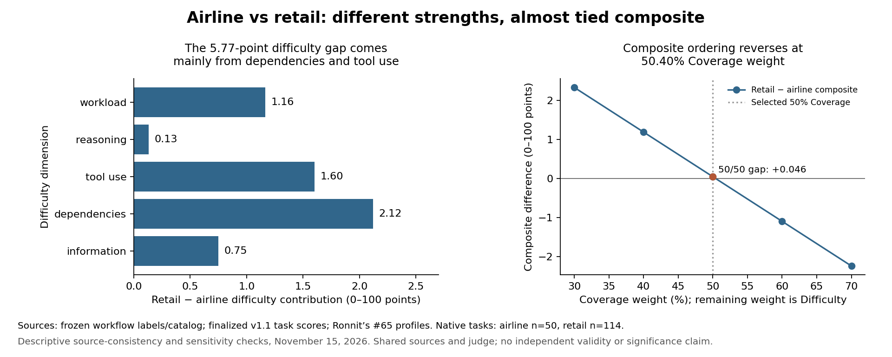

# Airline–retail differences: what is meaningful? — #66

**Completed:** Ronnit’s #65 profiles reproduce exactly from the frozen inputs. The metrics describe different domain characteristics, but **the 0.046-point composite difference is an effective tie, not evidence that retail is better**. This completes a descriptive source-consistency review, not independent validation of the LLM’s ratings.



## Main findings

- **Coverage favors airline by 5.68 points:** airline C = **96.1475/100**; retail C = **90.4705/100**. Both represent all nine declared workflows, so this difference comes entirely from balance (normalized entropy 0.922950 vs 0.809411), not missing workflow categories. Retail item changes appear in **73/114 tasks**, contributing to its concentrated workflow mix. Tasks can carry several workflow labels: airline has 89 memberships across 50 tasks and retail has 214 across 114, so membership counts are not independent task counts. Completeness alone would miss this distinction. Workflow labels/catalogs are curated project inputs, not externally validated scope.
- **Designed Difficulty favors retail by 5.77 points:** **64.8684 vs 59.10**. The largest contributions to this difference are dependencies/coordination (**+2.12 points**), tool use (**+1.60**) and workload (**+1.16**); information contributes +0.75 and reasoning only +0.13. The result therefore does not support a blanket claim that retail requires much more reasoning. These decompositions explain the saved LLM ratings, not independently measured task complexity.
- **The components cancel at the selected 50/50 weighting:** airline **77.6238**, retail **77.6695**. The exact gap is **0.045728**, with retail slightly higher. At about **50.3995% Coverage**, they tie; a larger Coverage weight favors airline. The saved difficulty scores are unchanged. Even a hypothetical five-point increase to one airline task’s rating would reverse this composite ordering. That is an arithmetic sensitivity illustration, not a correction or an uncertainty interval.

## Are the difficulty differences stable enough to describe?

The observed retail-minus-airline mean gap remains positive after removing any **one** task from either domain: the gap ranges from **5.17 to 6.40 points**. This is a leave-one-task-out sensitivity check, not an independence assumption or a confidence interval. It does not establish robustness to removing a whole related scenario family, changing the rubric or using another judge.

The distributions overlap substantially. Airline spans **30–90**, median **60**, middle 50% **50–70**; retail spans **50–80**, median **67.5**, middle 50% **55–75**. Across the 5,700 descriptive airline–retail pairs, retail is higher with ties given half credit in **63.45%** of pairs. These pairs are not independent observations for a significance test. The correct claim is “retail has a higher designed-difficulty mean in this task collection,” not “every retail task is harder than every airline task.”

## Do concrete task requirements fit the pattern?

Two illustrative, post-scoring examples are preserved in `examples.json` with their saved source citations. They are not a held-out validation sample.

- **Airline task 0: 50/100** (five levels of 2). The intended endpoint is a policy-compliant refusal after establishing that cancellation eligibility is not met. The policy requires checking the reason and applicable conditions before acting; the API itself does not enforce eligibility. The design still requires discovery and checks before the valid refusal, then stops without cancellation/refund work that is no longer required.
- **Retail task 0: 70/100** (3 workload, 3 reasoning, 3 tool use, 3 dependencies, 2 information). The requested exchange coordinates two product variants, ordered item/replacement lists, payment selection and explicit confirmation before one exchange request. Policy requires gathering all changes before the once-per-order tool call and authenticating before disclosing order/product information. This supplies concrete support for tool and dependency requirements beyond merely counting reference calls.

Exact policy excerpts, original line numbers and source hashes are in `policy_evidence.json`. The original policies remain unchanged. Requirements and cited examples are consistent with the rating explanations; inspecting the same design sources as the judge cannot independently verify that 50 and 70 are the right numerical ratings.

## Task mix and catalog limitations

Airline has **50 tasks**, retail **114**, telecom **114**. Dataset Difficulty must use these task counts: the weighted domain means reproduce τ²’s **64.1546762590**, while an equal-domain average would answer a different question. The seven synthetic groups also reconstruct their equal-task mean of **63.75**.

Task counts alone do not prove what caused the gap. Airline and retail catalogs contain different activities despite each having nine labels, and related tasks/workflows share requirements. `workflow_profiles.csv` supplies within-domain task counts and Difficulty means for follow-up; multi-label tasks occur in several groups, so those workflow means must not be averaged to reconstruct domain means or treated as a matched causal comparison. For example, airline booking tasks average 72.5 while its insurance-change tasks average 40; domain labels alone do not determine difficulty.

Telecom’s **3/3** workflow catalog and high balance are not evidence of broader coverage than a nine-workflow catalog. Its separate condition catalog (19/20 represented) is not double-counted. Small synthetic groups (6–13 tasks) and singleton workflows make their entropy/depth interpretation particularly sensitive to task selection. Vendi remains a separate historical diagnostic.

**Do not reconstruct the dataset composite by averaging domain composites.** Domain Coverage is calculated against each own catalog; dataset Coverage pools workflow completeness and gives group entropies equal weight, whereas Difficulty gives tasks equal weight. Consequently, task-weighted domain composites give τ² **79.5582**, not the published **79.6692**; synthetic **76.9207**, not **75.8523**. This is a documented aggregation difference, not a changed score. Use the frozen dataset formula for dataset headlines.

## Conclusion and handoff

The metrics detect **describable differences in workflow balance and the saved designed-complexity profile**, while the composite obscures those differences. Show the components, distributions and task counts together; label airline and retail effectively tied on the selected composite. Do not claim universal dataset quality, statistical significance, a causal domain effect, numerical gold validity or prediction of baseline agent failures.

The historical baseline diagnostics shown in #65 measure a separate agent’s outcomes; synthetic all-failed results are not reused to validate these scores. No new empirical correlation analysis or runtime test was performed here. Most task ratings have one judgment, and the few repeated development cases do not provide a domain-level error bound.

This report is ready for #67’s findings and #69’s final report. #66 is complete within its documented descriptive scope; independent validation and matched task-family analyses remain future work rather than a reason to rerun paid judging now.

## Evidence and reproduce

`issue65_snapshot/` preserves Ronnit’s README, domain profiles, provenance and GitHub source metadata. The CSV and Markdown snapshots normalize line endings for local readability; upstream Git blob IDs are retained. His provenance fingerprints match the local frozen files. All **10** domain profiles were independently recomputed, and all **342** coverage/Difficulty task IDs join exactly. Contribution sums and dataset mean reconstruction are checked. All calculations are offline; supplied tasks, final scores, rubric and selected weights are unchanged.

From the repository root:

```bash
python results/domain_validation_v1/analyze.py
python results/domain_validation_v1/plot.py
```

`findings.json`, `dimension_contributions.csv`, `weight_sensitivity.csv`, `workflow_profiles.csv`, `examples.json`, `policy_evidence.json` and `verification.json` retain full precision and input fingerprints. The scripts do not construct an API client or run an agent.
